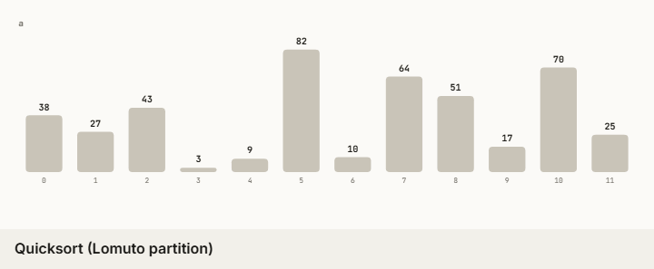
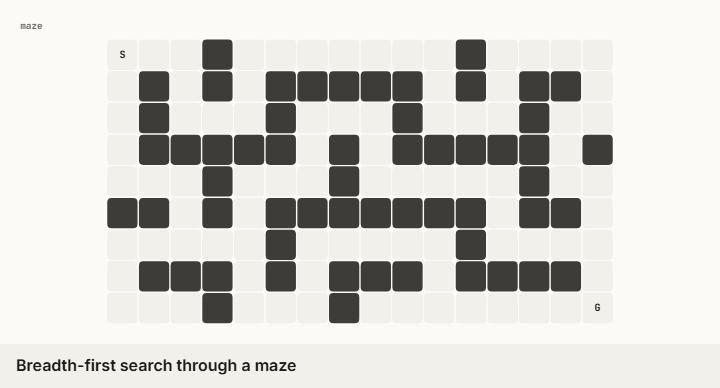
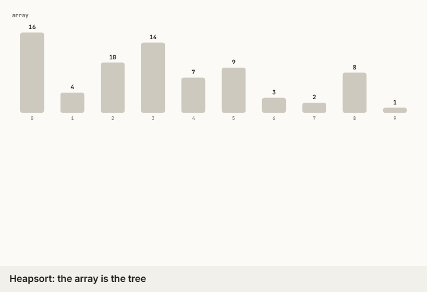
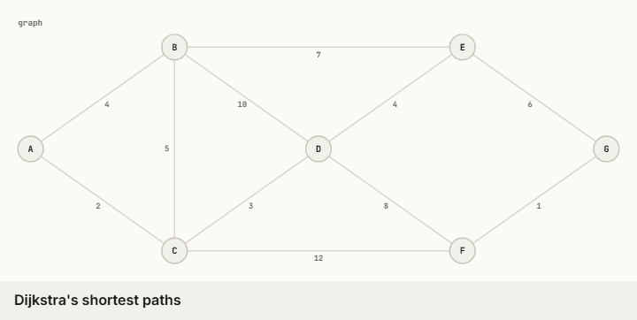
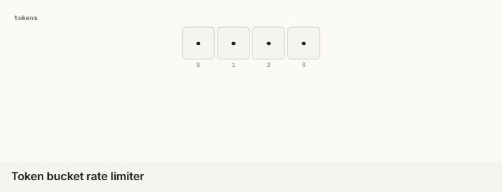
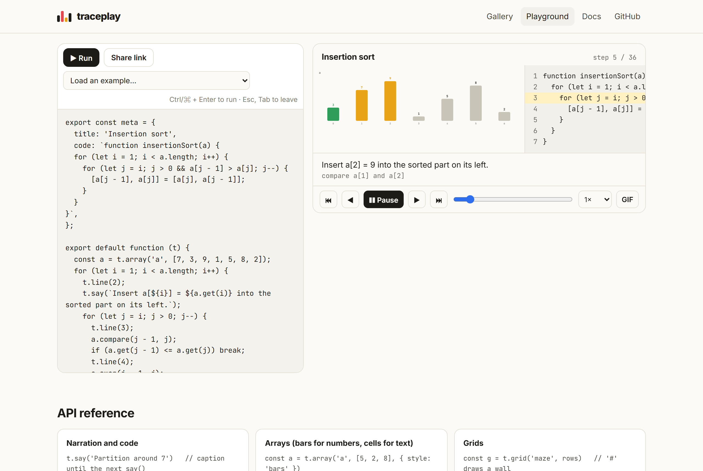

<div align="center">

# traceplay

### Watch any code run.

**Turn any algorithm or function into an interactive, step-by-step animation, where every frame comes from actually running the code.**<br>
Ask your AI agent to animate anything, or write a trace in a few lines. Share it as a link, a GIF or a single HTML file.

[](https://feresbr1.github.io/traceplay/)
[](#ask-your-agent)
[](https://github.com/feresbr1/traceplay/releases/latest)
[](LICENSE)



**[Gallery](https://feresbr1.github.io/traceplay/#gallery) · [Playground](https://feresbr1.github.io/traceplay/#/play) · [Agent skill](#ask-your-agent) · [CLI](#command-line) · [API](skills/traceplay/REFERENCE.md)**

</div>

---

## Why

Explaining how code works is most of teaching, onboarding, code review and technical writing, and a picture of it running beats a paragraph every time. But animations have always meant hand-drawing frames, or specialised tools with fixed algorithm menus. [algorithm-visualizer](https://github.com/algorithm-visualizer/algorithm-visualizer) (49k★) proved how much people want this, and it hasn't been updated since 2024.

traceplay takes a different approach. **You run the real code, and it records what happens.** A trace is your algorithm with a few calls that say what to show (`a.swap(i, j)`, `g.mark('B', 'visited')`, `t.say('…')`). Every change becomes a frame, so the animation can't drift from the code. Because the API is small and deterministic, coding agents are very good at writing traces. That turns "explain this function" into an interactive player in one prompt.

## What you get

<table>
<tr>
<td width="50%"></td>
<td width="50%"></td>
</tr>
<tr>
<td><b>Grids</b>: BFS through a maze, then the shortest path</td>
<td><b>Two views at once</b>: heapsort's array <i>is</i> the tree</td>
</tr>
<tr>
<td></td>
<td></td>
</tr>
<tr>
<td><b>Graphs</b>: Dijkstra with live distances</td>
<td><b>Real systems code</b>: a token-bucket rate limiter</td>
</tr>
</table>

- **Arrays, grids, graphs, trees and variables**, with smooth motion: swapped items slide, trees re-balance in place, and colours fade between states.
- **The source code beside the animation**, with the current line highlighted and narration under every step.
- **A real player**: play, pause, scrub, 0.5–4× speed, and keyboard control (Space, ←, →, Home, End).
- **Share anywhere**: a playground link, a GIF exported in the browser, or one self-contained HTML file you can open offline or embed with an `<iframe>`.
- **Agent-native**: a skill for Claude Code, Codex, Cursor and other agents, plus a `check` command that tells an agent whether its trace is good.
- **No dependencies, no account, no server.** Everything runs locally or in your browser.

## Ask your agent

Install the skill (works with Claude Code, Codex, Cursor, OpenCode, Gemini CLI and other [Agent Skills](https://github.com/vercel-labs/skills) agents):

```sh
npx skills add feresbr1/traceplay
```

Then ask:

```text
/traceplay animate how quicksort partitions around the pivot
/traceplay show how the LRU cache in src/cache.ts evicts entries
/traceplay explain our rate limiter's decision for a burst of 12 requests
```

The skill tells the agent to copy the **real implementation** into a trace, run it on a small, telling input, check it with `traceplay check`, and render it with `traceplay render`. The [token-bucket example](examples/token-bucket.trace.js) was written exactly that way: its verdict (8 accepted, 4 rejected) matches a separate run of the original class.

## Try it in your browser

Open the **[playground](https://feresbr1.github.io/traceplay/#/play)**, edit the code and press Ctrl/⌘ + Enter. Code runs in a sandboxed worker with a time limit. "Share link" puts the whole trace into the URL.



## Write a trace

```js
// insertion.trace.js
export const meta = {
  title: 'Insertion sort',
  code: `function insertionSort(a) {
  for (let i = 1; i < a.length; i++) {
    for (let j = i; j > 0 && a[j - 1] > a[j]; j--) {
      [a[j - 1], a[j]] = [a[j], a[j - 1]];
    }
  }
}`,
};

export default function (t) {
  const a = t.array('a', [7, 3, 9, 1, 5]);
  for (let i = 1; i < a.length; i++) {
    t.line(2);
    t.say(`Insert ${a.get(i)} into the sorted part on its left.`);
    for (let j = i; j > 0; j--) {
      t.line(3);
      a.compare(j - 1, j);
      if (a.get(j - 1) <= a.get(j)) break;
      t.line(4);
      a.swap(j - 1, j);
    }
  }
  t.say('Sorted.');
}
```

<h2 id="command-line">Command line</h2>

Node.js 18.17+, no dependencies. The CLI is a single file with the player embedded.

```sh
npx github:feresbr1/traceplay init insertion           # starter trace (--template array|graph|grid|tree)
npx github:feresbr1/traceplay check insertion.trace.js  # run it and get a quality report
npx github:feresbr1/traceplay render insertion.trace.js --open
# ✔ 16 steps → insertion.html
```

| Command                                                                     | What it does                                                                                                                                                               |
| --------------------------------------------------------------------------- | -------------------------------------------------------------------------------------------------------------------------------------------------------------------------- |
| `render <file> [-o out.html] [--theme light\|dark\|auto] [--json] [--open]` | Runs the trace and writes a self-contained interactive HTML player (or the raw trace JSON)                                                                                 |
| `check <file>`                                                              | Runs the trace and reports frames, structures, narration and code-line coverage, with warnings (missing narration, line numbers past the end of the code, too many frames) |
| `init [name] [--template …]`                                                | Creates a starter trace                                                                                                                                                    |
| `docs`                                                                      | Prints the [API reference](skills/traceplay/REFERENCE.md)                                                                                                                  |

Trace files can import your own modules. They work in ES-module and CommonJS projects alike.

## The API in one screen

```js
t.say('caption')  t.line(n)  t.step()  t.batch(() => { … }, 'event')

const a = t.array('a', [5, 2, 8])          // bars for numbers, cells for text
a.compare(i, j)  a.swap(i, j)  a.set(i, v)  a.mark(i, 'done')  a.pointer('lo', i)
a.push(v)  a.pop()  a.shift()  a.unshift(v)

const g = t.grid('maze', rows)              // '#' is a wall
g.mark(r, c, 'visited')  g.pointer('me', r, c)

const gr = t.graph('g', { nodes, edges, directed, layout })   // circle | force | layered | manual
gr.neighbors(id)  gr.mark(id, 'done')  gr.markEdge(a, b, 'path')  gr.badge(id, dist)

const tr = t.tree('bst')                    // binary; { binary: false } for n-ary
const root = tr.setRoot(50); tr.add(root, 30, 'left'); tr.attach(id, parent, side)

const v = t.vars('state', { lo: 0 }); v.set({ lo: 3 })
```

Tones: `active` `compare` `swap` `done` `visited` `frontier` `path` `found` `muted` `error` `pivot`. Full details are in [REFERENCE.md](skills/traceplay/REFERENCE.md).

## How it compares

|                                                                   | traceplay         | algorithm-visualizer               | Python Tutor       | Hand-made animation |
| ----------------------------------------------------------------- | ----------------- | ---------------------------------- | ------------------ | ------------------- |
| Visualizes your own code                                          | ✓                 | via its tracer API, in its web IDE | ✓ (small programs) | ✓                   |
| Frames come from a real run                                       | ✓                 | ✓                                  | ✓                  | ✗                   |
| Shows the _concept_ (bars, graphs, grids, trees), not just memory | ✓                 | ✓                                  | memory diagrams    | ✓                   |
| Works with AI coding agents                                       | ✓ skill + `check` | ✗                                  | ✗                  | ✗                   |
| Exports a GIF / standalone HTML                                   | ✓                 | ✗                                  | ✗                  | depends             |
| Runs locally, no server                                           | ✓                 | needs its web app                  | needs its web app  | ✓                   |
| Last updated                                                      | 2026              | June 2024                          | —                  | —                   |

## Gallery

Every example in [`examples/`](examples) runs live on the [website](https://feresbr1.github.io/traceplay/#gallery): quicksort, a token-bucket rate limiter, BFS through a maze, heapsort, Dijkstra, Game of Life, binary search, a binary search tree, topological sort, and a sliding window. Contributions of new traces are very welcome.

## How it works

1. **Record.** The trace runs with tracked structures. Each change takes a snapshot of every structure, plus the narration and code line, and stores it as a frame. Highlights such as `compare` last one frame; `mark` lasts until removed.
2. **Lay out.** Each frame becomes a scene of keyed shapes (bars, cells, nodes, edges, labels). Graph layouts are deterministic and stay fixed across frames. Trees use in-order positions, so a BST reads left to right in sorted order.
3. **Animate.** Moving between frames interpolates shapes with the same key (position, size, colour), so items slide instead of jumping. The canvas is drawn at device resolution, which is also what the GIF encoder captures.

## Limits

- Traces are JavaScript. To animate code in another language, port the algorithm faithfully (the agent skill does this).
- At most 5,000 frames per trace. Use `t.batch()` for bulk updates and a small, telling input.
- Exported GIFs cover up to 300 steps; very long traces are better shared as HTML or links.
- The playground can't use `import`; the CLI can.

## Development

```sh
git clone https://github.com/feresbr1/traceplay && cd traceplay
npm install
npm run dev                 # website at http://localhost:5173/traceplay/
npm test                    # tracer, layouts, every example, HTML export, CLI
npm run build:web && npm run test:e2e   # Playwright: gallery, player, playground, GIF export
npm run check               # format, lint, typecheck, tests, build
```

`dist/cli/traceplay.mjs` is committed so `npx github:feresbr1/traceplay` works without a build. See [CONTRIBUTING.md](CONTRIBUTING.md).

## License

[MIT](LICENSE)
